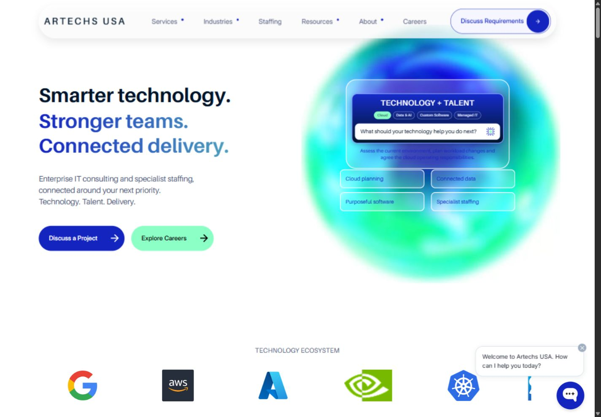
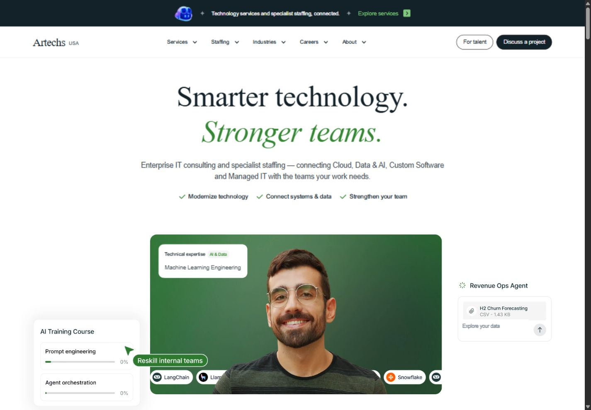

# Artechs USA — Design Lab

Three responsive frontend design directions prepared for a technology consulting and staffing client: **Signal**, **Human** and **Atlas**.

[Explore the designs](https://artechs-usa-client-review.vercel.app/) · [Delivered website](https://github.com/attaulhaq0/artechsusa-website) · [Website portfolio](https://github.com/attaulhaq0/website-work)

React and Vite provide the design selector, page navigation and motion controls. Each direction has its own HTML pages, styles, media and interactions. These are frontend previews; contact and application forms do not send real submissions.

## Designs

| Direction | Focus | Pages |
| --- | --- | ---: |
| Signal | Blue and mint palette, connected technology stories and motion | 24 |
| Human | Editorial typography, people-focused layouts and candidate journeys | 25 |
| Atlas | Dark and light presentation, enterprise navigation and interactive service content | 31 |

<details open>
<summary>Signal — preview</summary>



[Open Signal](https://artechs-usa-client-review.vercel.app/?design=signal)

</details>

<details>
<summary>Human — preview</summary>



[Open Human](https://artechs-usa-client-review.vercel.app/?design=human)

</details>

<details>
<summary>Atlas — preview</summary>


[Open Atlas](https://artechs-usa-client-review.vercel.app/?design=atlas)

</details>

## Run locally

Requires Node.js 22 or later.

```sh
npm ci
npm run dev
```

Open the local URL printed by Vite. Use the direction buttons and page dropdown to browse; use Play/Pause to control motion.

```sh
npm test
npm run build
npm run preview
```

## Code

- `src/replicas/ReplicaReview.jsx` — direction selection, URL state, page navigation, iframe messaging and motion preferences.
- `public/replicas/` — page inventories, static pages and each direction's runtime assets.
- `tests/` — page inventory and local dependency checks.

The delivered site is maintained separately in [artechsusa-website](https://github.com/attaulhaq0/artechsusa-website). Preview pages remain excluded from search indexing. Third-party notices remain with their assets.

Maintained by [Sheikh Atta-ul-Haq](https://github.com/attaulhaq0).

