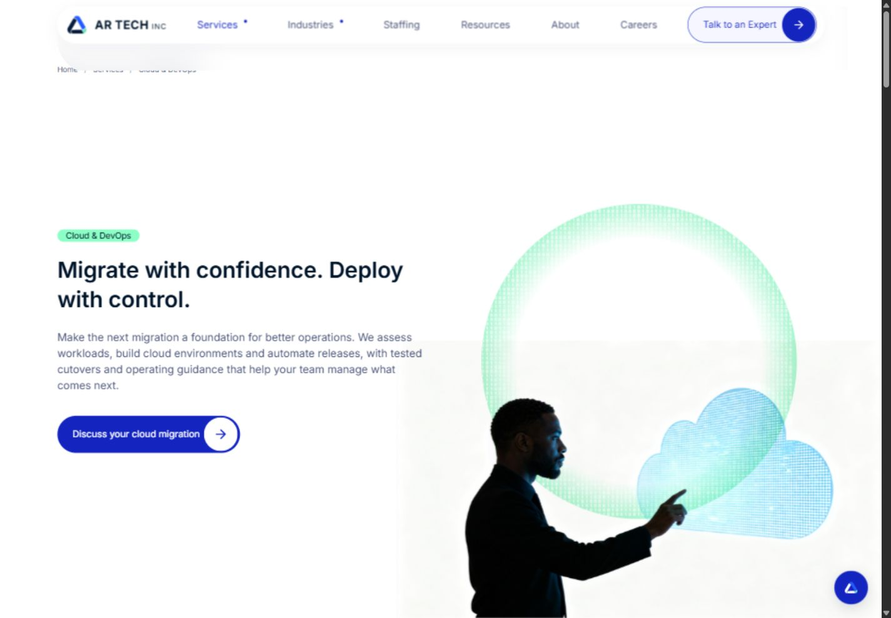

# AR TECH INC — Website

A delivered website for a technology consulting and staffing business, covering services, industries, careers and enquiry journeys.

[Live website](https://artechsusa.com/) · [Design previews](https://github.com/attaulhaq0/artechsusa-design-lab) · [Website portfolio](https://github.com/attaulhaq0/website-work)


## Work

- Responsive layouts, typography, navigation and reusable page styles across 27 routes.
- Service and industry pages, interactive delivery graphics and an on-site information assistant.
- Contact and application forms with PHP validation, signed tokens, rate limits, verified SMTP/TLS and résumé attachments.
- Crawlable HTML, unique metadata, canonical URLs, JSON-LD and a sitemap covering 24 indexable pages. [Technical SEO](docs/seo.md)
- Consent controls for analytics and local font/media assets.

HTML, CSS and JavaScript power the frontend. PHP and PHPMailer handle submissions. The delivered site runs on Hostinger.

<details>
<summary>Service page and mobile layout</summary>




</details>

## Run locally

Requires PHP 8.4 with OpenSSL, fileinfo and mbstring.

```sh
php -S 127.0.0.1:4290 -t public_html scripts/dev-router.php
```

Open `http://127.0.0.1:4290/`. Static pages need no build step. Forms remain disabled until a private configuration is supplied.

## Verify

Requires Python 3.12 or later and PHP on your PATH.

```sh
python -m pip install -r requirements-dev.txt
python tests/test_site.py
python tests/test_forms.py
```

The five site checks cover routes, metadata, sitemap consistency, structured data and local dependencies. The sixteen form tests exercise the actual PHP endpoints against a local SMTP/TLS fixture, including validation, token expiry, throttling, attachment handling and certificate rejection. No external email is sent. Set `PHP_BIN` and optionally `PHP_INI` when PHP is outside your PATH.

## Deployment layout

```text
public_html/              Website document root and PHP endpoints
private/                  Form handler, PHPMailer and configuration example
scripts/dev-router.php    Local URL routing
tests/                   Site and form integration checks
docs/                    Screenshots and technical SEO notes
```

Upload `public_html/` as the document root and place `private/` beside it. Copy `private/forms-config.example.php` to `private/forms-config.php`, configure it on the server and enable submissions. Keep configuration, credentials and runtime files outside the document root and Git. The example contains no passwords or API keys.

Third-party licenses remain in `private/vendor/` and `licenses/`.

Maintained by [Sheikh Atta-ul-Haq](https://github.com/attaulhaq0).


